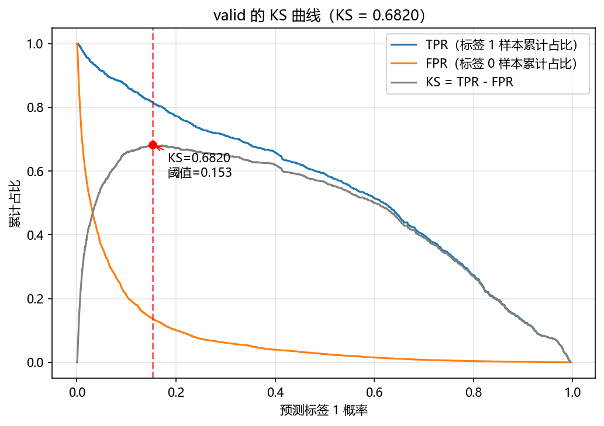
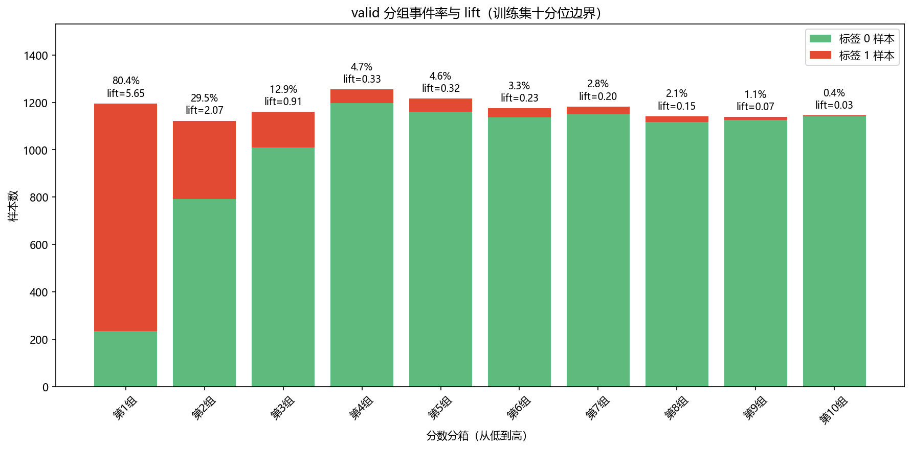

# 基于 WOE 与逻辑回归的贷款风险评分卡

使用 Kaggle 合成贷款数据完成 **数据探索 → 训练集分箱与 WOE 编码 → 变量筛选 → 逻辑回归 → 评分卡转换 → 验证评估**，重点展示可解释建模与可复现分析能力。

这是个人学习项目，不代表真实银行审批策略或已上线模型。`loan_status=1` 在本项目中称为“风险事件”；数据缺少真实违约口径、表现窗口和时间字段。

**阅读入口：** [完整分析 Notebook](credit_scorecard.ipynb) · [可运行脚本](credit_scorecard.py) · [数据说明](data/README.md) · [结果表](reports/tables) · [代码变更说明](docs/CHANGES.md) · [简历与面试说明](docs/RESUME.md)

## 结果概览

在 58,645 条有标签记录中，按标签分层进行 80%/20% 划分，随机种子为 42。以下为本地验证结果，不是 Kaggle 榜单成绩。测试文件有 39,098 条无标签记录，仅用于生成预测。

| 集合 | 样本数 | 标签 1 占比 | AUC | KS |
|---|---:|---:|---:|---:|
| 训练集 | 46,916 | 14.24% | 0.9069 | 0.6664 |
| 验证集 | 11,729 | 14.24% | **0.9091** | **0.6820** |

完整精度见 [metrics.csv](reports/tables/metrics.csv)。最终模型使用 9 个 WOE 特征；没有新增复杂模型或使用测试标签调参。





第二张图采用**训练集十分位边界**，验证集各组人数不一定相等。最低分组事件率约 80.42%，Lift 约 5.65；最高分组事件率约 0.44%。这是本次样本中的排序结果，不是审批收益测算，也不代表未来样本仍有相同表现。

## 分析过程与主要选择

| 步骤 | 实际做法 | 选择理由与边界 |
|---|---|---|
| EDA | 检查类型、缺失、重复、标签比例、数值及类别分布 | 有标签数据无缺失、无完全重复特征；1 条年龄超过 100，2 条工龄大于年龄 |
| 异常记录 | 保留原始样本，记录质量问题 | 延续原始基线，不根据验证效果挑选清洗规则；分箱不代表数据合理 |
| 数据划分 | 分层随机划分，固定种子 | 维持事件比例；不等同于时间外验证 |
| WOE | 仅训练集拟合 scorecardpy 自动决策树分箱，其他集合应用同一规则 | 避免验证集标签参与分箱；使用库默认分箱参数，未宣称人工单调分箱 |
| 相关性 | 移除 `loan_grade_woe` | 与利率 WOE 相关系数约 0.913，信息高度重叠 |
| VIF / IV | 含截距的 VIF 诊断，并展示 IV | 未使用 IV 阈值或 VIF 循环自动筛选 |
| 变量筛选 | 向前加入、向后剔除的逐步逻辑回归，p 阈值均为 0.05 | 保留原学习方法；筛选后的 p 值不作严格推断 |
| 建模 | L2 逻辑回归，C=1，lbfgs | 未做大规模调参；保留模型收敛警告 |
| 评分卡 | 分箱 WOE 与回归系数换算为分值 | 输出基础分、变量分箱与分值，便于解释单条样本评分 |

最终变量为收入、利率、贷款收入比、住房状态、贷款用途、工龄、历史违约标记、年龄和贷款金额。具体系数见 [coefficients.csv](reports/tables/coefficients.csv)，分箱依据见 [woe_bins.csv](reports/tables/woe_bins.csv)。贷款收入比为数据已有字段，不是本项目新增衍生特征。

## 评分如何得到

令 `p=P(loan_status=1)`，评分公式为：

```text
B = PDO / ln(2)
A = points0 + B × ln(odds0)
Score = A − B × ln[p / (1 − p)]
```

- `points0=600`，`odds0=1/20` 是坏/好比，`PDO=50`。
- 600 分对应模型概率约 4.76%；好/坏比翻倍，评分增加 50 分。
- 总分为基础分加各变量分箱分值，各项四舍五入为整数。
- 不保证评分落在 300—900。本次训练分数范围为 −15～993，验证集为 −15～985。
- 本次验证集公式分与整数评分的最大绝对差约 2.65 分，在逐项取整误差上界内。

查看 [评分卡明细](reports/tables/scorecard.csv)。AUC/KS 衡量排序区分度，不证明输出概率已经完成校准。

## 扩展分析及局限

Notebook 第 19—20 节提供阈值、五档评级和 PSI 学习示例：

- 五档边界仅由训练集确定。验证集中 E→A 事件率约为 55.76%、8.65%、3.97%、2.45%、0.74%，本次呈下降关系。[评级表](reports/tables/valid_grades.csv)
- 训练集 30% 分位对应约 70% 通过率的模拟规则；同分样本使实际比例略有偏差。没有引入真实收益、损失或授信成本。[阈值示例](reports/tables/threshold_example.csv)
- 验证集最大 KS 对应阈值仅用于探索，不作为经过独立样本检验的审批阈值。
- 固定训练集分箱后，分数 PSI 在 train/valid 间约 0.0011、train/test 间约 0.0004，仅说明当前分布差异较小。[PSI 表](reports/tables/psi.csv)

尚未进行时间外验证、概率校准、真实策略回测或上线部署。利率等特征在实际审批时点是否可用，也需要在真实业务中另行核实。自动分箱及逐步筛选可能受样本影响，单次随机划分不能代替更充分的稳健性验证。

## 运行

已在 Python 3.10.21、pandas 2.3.0、scikit-learn 1.7.0、scorecardpy 0.1.9.7 环境复算。完整建模依赖固定在 [requirements.txt](requirements.txt)，实际版本保存于 [run_manifest.json](reports/tables/run_manifest.json)。

```bash
conda create -n credit-scorecard python=3.10 -y
conda activate credit-scorecard
python -m pip install -r requirements.txt
```

按 [数据说明](data/README.md) 下载并放置原始 CSV，然后在项目根目录运行：

```bash
python credit_scorecard.py
python tools/check_results.py
```

脚本直接保存结果，不弹出绘图窗口；重新运行会覆盖生成的结果。中文图形优先使用微软雅黑/黑体；Linux 可安装 Noto Sans CJK SC 字体。没有中文字体时计算不受影响，但图中文字可能缺失。

交互式阅读：

```bash
python -m notebook credit_scorecard.ipynb
```

请选择上述环境的 Python 内核，并从头运行。维护脚本后，可同步讲解 Notebook，再用当前 Python 环境完整执行：

```bash
python tools/sync_notebook.py
python tools/execute_notebook.py
python tools/check_results.py
```

同步命令会重建 Notebook 并清空旧输出；执行命令才会生成新输出。Notebook 讲解文字维护在 `tools/sync_notebook.py`，避免两份建模代码逐渐不一致。

## 目录

```text
├── README.md
├── requirements.txt
├── credit_scorecard.py           # 按原学习章节保留的主流程
├── credit_scorecard.ipynb        # 同一逻辑 + 分析说明 + 执行输出
├── data/README.md               # 数据来源、字段与口径
├── reports/
│   ├── figures/                 # 可展示的评估图
│   └── tables/                  # 指标、分箱、评分卡及运行记录
├── docs/
│   ├── CHANGES.md               # 修改内容、原因及影响
│   └── RESUME.md                # 简历描述与面试准备
├── tools/                       # 同步 Notebook、执行与结果核查
├── outputs/                     # 本地逐样本预测/分数/提交文件，Git 忽略
└── archive/                     # 原学习版本本地备份，Git 忽略
```

`reports` 保存汇总证据；`outputs/submission.csv` 只生成文件，不自动提交 Kaggle。原始数据、旧版本和逐样本输出均默认不进入 GitHub。

## 学习过程与参考

本项目为个人学习项目。核心建模流程参考公开资料完成，部分后续评估、可视化与项目整理使用 AI 辅助。仓库保留原有 WOE＋逻辑回归思路，并明确区分已实现工作与学习扩展；不声称全部内容为从零独立原创。

- [Kaggle 竞赛与数据](https://www.kaggle.com/competitions/playground-series-s4e10/data)
- [scorecardpy 官方仓库](https://github.com/ShichenXie/scorecardpy)
- [scikit-learn LogisticRegression](https://scikit-learn.org/stable/modules/generated/sklearn.linear_model.LogisticRegression.html)
- [statsmodels Logit](https://www.statsmodels.org/stable/generated/statsmodels.discrete.discrete_model.Logit.html)

以上为数据和工具参考，不冒充个人学习时实际使用的教程来源；如找回具体教程，应补充原作者和链接。
